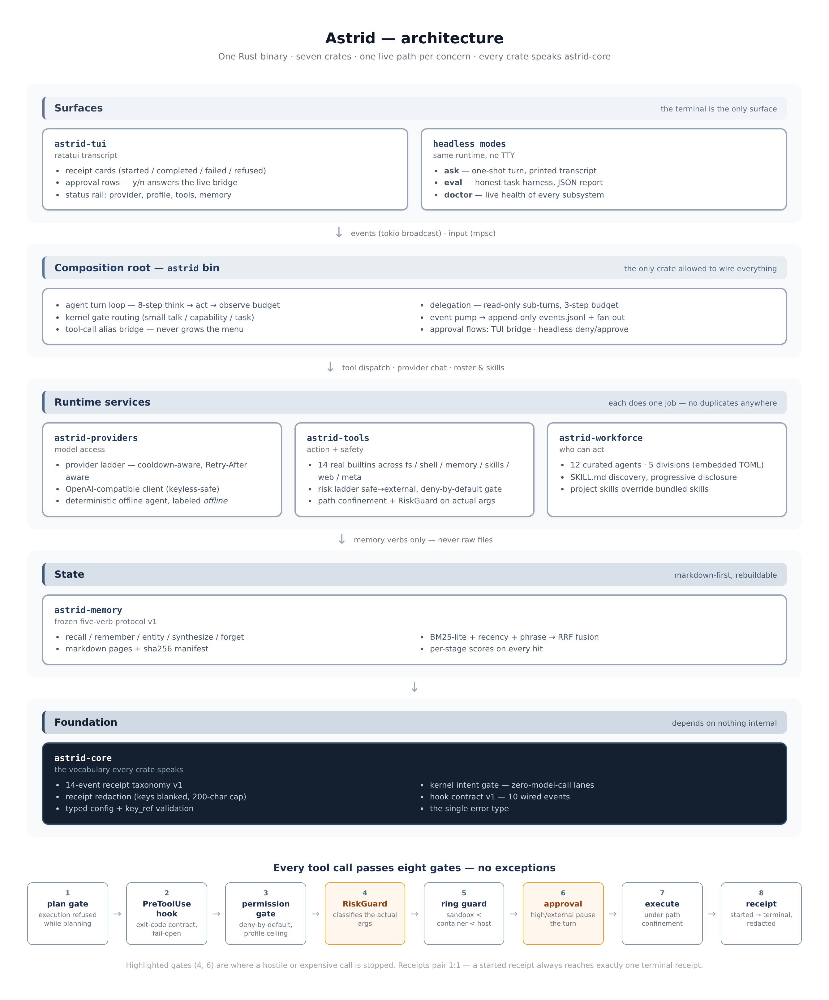

# Astrid

**A TUI-native agent operating system in Rust.**

Astrid plans, acts, remembers, and proves — in a terminal. One binary, one surface:
a keyboard-driven TUI backed by a Rust agent runtime with persistent markdown
memory, a permission-gated tool catalog, provider failover, and a receipt for
every tool call, so what the agent claims can be checked against what it did.

Astrid is a clean-room rebuild of the lessons learned from the Jexi OS project,
reduced to what actually runs. The port map — what was kept, cut, and
redesigned, and why — is [docs/PORT-MAP.md](docs/PORT-MAP.md).



## Principles

1. **One live path.** Everything in the tree is wired into the running binary.
   No museum modules, no second-generation stacks, no registry that nothing loads.
2. **Honest by construction.** No canned passes. A capability that is unavailable
   reports `unavailable` with the reason. An unverified answer says so.
   Without a provider, Astrid runs the deterministic fallback and says that is
   what you are talking to.
3. **Receipts for everything.** Every tool call emits `tool.started` /
   `tool.completed` / `tool.failed` receipts carrying redacted args, result
   preview, duration, and risk level, persisted to an append-only event log.
4. **Deny by default.** Tools are risk-classified (safe / medium / high /
   external). High and external tools require explicit approval in the TUI.
   Filesystem tools are path-confined to the session root.
5. **Frozen small protocols.** Five-verb memory protocol v1, 14-event receipt
   taxonomy v1, 10-event hook catalog v1 — each versioned, each fully wired.
   Astrid does not ship contract events it does not fire.
6. **Rust only, TUI only.** No web server, no browser bundle, no Electron, no
   desktop app. The terminal is the product.

## Agent OS surface (M5)

* **Streaming**: token deltas stream live from OpenAI-compatible providers
  (SSE, tool-call fragments re-assembled); without a provider the offline
  agent streams paced reveals, so the transcript always types.
* **Narration**: every phase of a turn speaks — ack, acting, progress,
  completion — with a dedicated icon and hue.
* **MCP**: stdio MCP servers wire into the same registry and receipt pipeline
  as builtins; tools default to High risk (approval before first external
  call). See [docs/M5-AGENT-OS.md](docs/M5-AGENT-OS.md).
* **Plugins**: `plugins/<name>/plugin.toml` manifests load at startup as
  first-class tools — no shell interpolation of model content.
* **Three palettes**: `midnight`, `nordic`, `ember` — one hue per role
  (user, assistant, narration kinds, tool families, approvals). `/theme
  <name>` switches live.

## Crates

| Crate | What it is |
|---|---|
| `astrid-core` | Events, receipts, config, errors, kernel intent gate, hook contract |
| `astrid-memory` | Five-verb memory protocol, markdown-backed store, BM25-lite hybrid search |
| `astrid-workforce` | Curated agent roster, divisions, skills discovery (`SKILL.md`) |
| `astrid-providers` | Provider ladder with SSE streaming, OpenAI-compatible client, deterministic offline fallback |
| `astrid-tools` | Tool registry, risk ladder, permission gate, path confinement, builtins, manifest plugins |
| `astrid-mcp` | MCP stdio client: server handshake, tool discovery, adapters behind the receipt pipeline |
| `astrid-tui` | Themed ratatui surface: streaming transcript, receipt cards, narration, approvals |
| `astrid` | The binary: composition root, agent turn loop, eval harness |

## Quick start

Requires Rust 1.75+ (`rustup` install is fine).

```bash
git clone https://github.com/astrid-os/astrid
cd astrid
cargo build --release
./target/release/astrid            # launches the TUI
```

First run creates `./.astrid/` with config, memory pages, and the event log.

**Provider.** Astrid talks to any OpenAI-compatible endpoint. Configure a ladder
in `.astrid/config.toml`:

```toml
[providers]
ladder = ["ollama", "groq", "pollinations"]   # tried in order, cooldown-aware
local_only = false

[providers.ollama]
base_url = "http://127.0.0.1:11434"
model = "llama3.2:3b"

[providers.groq]
model = "llama-3.1-8b-instant"
key_ref = "GROQ_API_KEY"        # env var NAME — never paste the key itself
```

Keys are only ever referenced by environment-variable name (`key_ref`).
Without any provider, Astrid still runs: the deterministic offline agent answers
with narration, tool receipts, and a turn-end row, and labels itself as offline.

**CLI modes** (same binary, no TTY needed):

```bash
astrid ask "what tools do you have?"   # one-shot turn, prints the transcript
astrid eval --tasks eval/tasks.json    # honest task harness, JSON report
astrid doctor                          # config, memory, providers, hooks health
```

## Status

v0.1.0 — core runtime complete and hermetic-test green: agent turn loop,
five-verb memory, curated toolset, permission gates, provider ladder,
hooks (10 wired events), receipts/event log, TUI, offline agent, eval harness.
Roadmap (v0.2+): MCP client, dream-cycle consolidation, multi-agent delegation.

## License

MIT — see [LICENSE](LICENSE).
